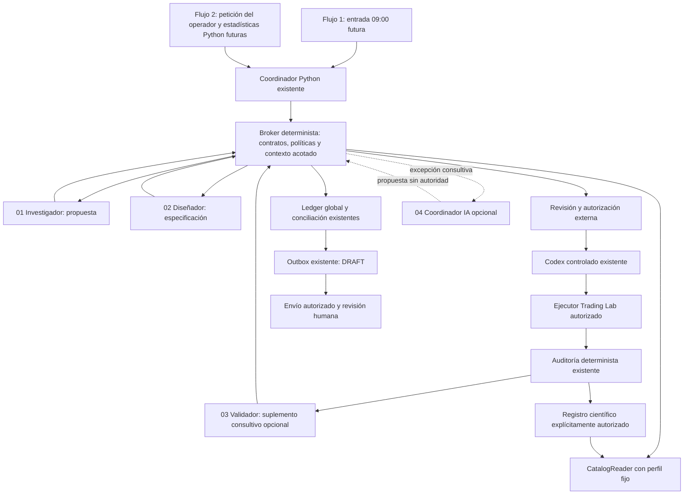

# Trading Lab — Arquitectura multiagente V1

Especificación documental 1.0 · Fase 5.9B.0 · Base verificada de main:
`077acd4bb1956c8e10302c45708c4bdc112be0df`.
Estado: diseño para revisión; ninguna conexión, migración o llamada autorizada.

## 1. Gobierno, alcance y fuentes de verdad

El coordinador Python existente seguirá siendo el único controlador del circuito.
Los modelos producen propuestas o explicaciones; no ejecutan sus propias decisiones.
Codex conserva el papel de implementador acotado. El motor y los verificadores
deterministas conservan los cálculos, las clasificaciones y la acreditación.
El operador autoriza cada acción protegida mediante su frontera existente.

Este diseño no activa agentes, presupuesto, scheduling, GitHub, Telegram, datos,
backtests, paper, demo o live. Tampoco cambia instrucciones del repositorio.
Los bloques de instrucciones de los documentos de agente son propuestas de
configuración futura, no instrucciones que deba ejecutar el lector del documento.

Git confirma que 5.9A está integrada en esta base. PROJECT_STATE y la guía 5.9A
todavía describen su integración como pendiente: son textos anteriores al merge,
no evidencia contra el commit. Se conservan sin corregir fuera de este alcance.
Los conteos 40 estrategias, 41 versiones y el expediente Issue #3 proceden de la
última aceptación comunicada; no se abrió la SQLite real para recertificarlos aquí.
Se preservan NO_DECISION, CONSUMED y RESET_PER_SEGMENT; no hay promoción a demo.

Índice normativo de esta propuesta:

- [Investigador](agent-01-quant-researcher.md).
- [Diseñador](agent-02-strategy-designer.md).
- [Validador](agent-03-quant-validator.md).
- [Coordinador](agent-04-coordinator.md).
- [Contratos](agent-contracts-v1.md).
- [Permisos y contenido no confiable](agent-permissions-v1.md).
- [Presupuesto](agent-budget-policy-v1.md).
- [Plan de pruebas y entregas](agent-test-plan-v1.md).

## 2. Diseño anterior recuperado y adaptaciones

Se recuperaron realmente cuatro documentos locales del paquete del 3 de noviembre
de 2026. Sus bytes individuales coinciden con los miembros del ZIP original.
No se importan al repositorio ni se adoptan como instrucciones privilegiadas.

| Fuente recuperada | SHA-256 |
|---|---|
| trading_lab_arquitectura_multiagente_maestra_v1.md | d20146912879971fac25819c1936dcbdcd8194a70721d5cfe8d9c330ed7474b0 |
| trading_lab_investigador_cuantitativo_v1.md | 8da7d5aca0c44b9c227edf68ab101fcb989124a36c3ec20151854ac38dce4b4f |
| trading_lab_agente_02_desarrollador_cuantitativo_v1.md | 7802d28c26d7eb66a4adf7a766656cfcb22c48fea301138cb1e2322811a0696a |
| trading_lab_agente_03_auditor_cuantitativo_v1.md | f3385c19c60aa7706dd57d40a46167e870e36720e3f87feb29dea29254a721e6 |

ZIP `trading_lab_paquete_multiagente_v1.zip`:
`5c86f1a4e3f3555d26307d1180f9be9cd22653da5ba12e3975d5706c7ad53045`.
La referencia Git de aquel maestro era `131ffaa101f7d04d81dcb47936142802ebba0a4b`.

| Diseño anterior | Adaptación a esta base |
|---|---|
| Tres roles IA, incluido desarrollador/Codex | Cuatro roles de consulta; el Diseñador especifica y Codex implementa por el adaptador existente. No se crea otro LLM desarrollador |
| Coordinador Python | Se conserva; la consulta IA del coordinador será excepcional y deshabilitada por defecto |
| Doce tablas conceptuales nuevas | No se copian. Se reutilizan Store v7, catálogo V1, ledger y outbox existentes |
| Memoria conceptual en el coordinador | La memoria científica ya existe en el catálogo; el coordinador conserva tareas y permisos, no otra copia de resultados |
| HypothesisManifest conceptual | Prevalece HypothesisManifest 1.0 implementado, con tipos, reglas y fingerprint reales |
| ImplementationReceipt conceptual y campos de presupuesto | Prevalecen ImplementationRequest, ModelDelivery y recibo anfitrión reales; no se inventa un límite CPU/API medido |
| Auditor con posibles recomendaciones de promoción | El LLM conserva ModelReview y NO_DECISION; su recomendación consultiva no concede elegibilidad |
| Algunas referencias a VectorBT | El motor ordinario es StudyBackend v1; protocolos especializados siguen separados |
| Piloto de una hipótesis/día | Primeras pruebas simuladas con una solicitud; objetivo posterior de hasta 2–3 propuestas/día sujeto al ledger compartido |
| Hora 09:00 como entrada objetivo | Conector y autorización pendientes; no se supone entrega automática desde ChatGPT |

Se conservan independencia, cuatro puertas de análisis, falsación, identificación
exacta, evidencia inmutable, mínimos privilegios y separación de cuota Codex/API.

## 3. Componentes existentes y reutilización verificable

Todas las referencias siguientes corresponden a archivos de la base indicada.
Que exista una función no significa que esté autorizada en esta fase.

| Componente | Implementación existente | Reutilización y límite |
|---|---|---|
| Descubrimiento y memoria | [catálogo V1](../strategy-catalog-v1.md), [API 5.9A](../strategy-catalog-read-api-v1.md), [read_api.py](../../src/trading_lab_catalog/read_api.py) | CatalogReader y sus cuatro perfiles; solo lectura. El LLM no recibe Store ni LocalEvidenceReferences |
| Admisión científica | [contracts.py](../../src/trading_lab_orchestration/contracts.py), [paso 4.1](../orchestration-step-4.1.md) | HypothesisManifest 1.0, snapshot y fingerprint exacto; no admite hipótesis parciales como fichas completas |
| Persistencia operativa | [store.py](../../src/trading_lab_orchestration/store.py), [migration.py](../../src/trading_lab_orchestration/migration.py) | Store con esquema objetivo v7; no abrir, inicializar o migrar una base real durante este diseño |
| Entrada de investigación | [research_intake.py](../../src/trading_lab_orchestration/research_intake.py), [guía](../orchestration-research-intake.md) | Batch/Idea/Selection: una selección de hechos entregados, no un investigador general con navegación y herramientas |
| GitHub intake | [github_intake.py](../../src/trading_lab_orchestration/github_intake.py), [5.1](../orchestration-phase-5-1.md) | Author allowlist, revisión local y deduplicación; no publica ni implementa por sí mismo |
| Codex | [implementation.py](../../src/trading_lab_orchestration/implementation.py), [adaptador](../../src/trading_lab_orchestration/codex_adapter.py), [4.2](../orchestration-step-4.2.md) | Coordinator y CodexCLI; reserva, worktree/allowlist, entrega no confiable y recibo validado. No se invoca aquí |
| Ejecutor | [execution.py](../../src/trading_lab_orchestration/execution.py), [contratos](../../src/trading_lab_orchestration/execution_contracts.py), [4.3](../orchestration-step-4.3.md) | Executor y ExecutionPlan; datos fijados, presupuesto de volumen/tiempo y ejecución autorizada |
| Auditoría | [audit.py](../../src/trading_lab_orchestration/audit.py), [contratos](../../src/trading_lab_orchestration/audit_contracts.py), [4.4](../orchestration-step-4.4.md) | Auditor, AuditVerdict y referencias primarias. El ModelReview es suplemento |
| Ledger global | [audit_model.py](../../src/trading_lab_orchestration/audit_model.py), [billing.py](../../src/trading_lab_orchestration/billing.py), [guía](../orchestration-openai-billing.md) | Budget/ExistingBudgetStore y conciliación. Cap 2000 céntimos; un pendiente bloquea nuevas llamadas |
| Adaptador API | [audit_openai.py](../../src/trading_lab_orchestration/audit_openai.py), [guía](../orchestration-openai-auditor.md) | Petición acotada sin tools, recibo y precio verificado; perfil temporalmente caducado en la base leída |
| Conexión técnica | [circuit.py](../../src/trading_lab_orchestration/circuit.py), [CircuitRequest](../../src/trading_lab_orchestration/circuit_contracts.py), [flow1.py](../../src/trading_lab_orchestration/flow1.py) | CircuitRunner y checkpoints existentes; restringidos a perfiles/fingerprints técnicos congelados |
| Avisos | [audit_notifications.py](../../src/trading_lab_orchestration/audit_notifications.py), [4.4](../orchestration-step-4.4.md) | Outbox.preview/send/reconcile. NOTICE_PREPARED no significa envío; ACCEPTED no prueba lectura humana |
| Histórico especial | [historical_pilot.py](../../src/trading_lab_orchestration/historical_pilot.py), [5.5B](../orchestration-phase-5-5b.md) | Autorización canónica del Issue #3 consumida; no es un permiso general ni se reutiliza |

## 4. Arquitectura objetivo compartida

Todas las flechas describen conexiones objetivo. Las conexiones nuevas están
pendientes; los ensayos técnicos existentes no acreditan este recorrido general.
No existe comunicación agente→agente que eluda el broker ni acceso directo al motor.
La prioridad de implementación es completar el Flujo 1 hasta una notificación
Telegram verificable y autorizada. El Flujo 2 comparte esta arquitectura, pero su
integración de extremo a extremo se abordará después; 6.0B no se activa aquí.

El broker es una futura adaptación dentro de trading_lab_orchestration, no otro
orquestador, servidor o framework. Recupera contexto por el perfil real, valida
límites y produce un paquete sin rutas privadas. Inicialmente preconsulta el catálogo
antes de una única petición: no se habilitan herramientas del proveedor ni bucles
de razonamiento autónomos. Peticiones adicionales de lectura serán propuestas JSON
restringidas y, si se implementan, requerirán validación y límites de rondas explícitos.
Las inspecciones internas de estado usarán ReadOnlyStore y snapshots existentes;
no un constructor que inicialice o migre la cola al consultar. Store con escritura
se reserva para operaciones autorizadas del host, nunca como herramienta del modelo.
La coherencia de varias respuestas del catálogo no se presume: el broker aplicará
la regla de checkpoint común y captura acotada descrita en permisos. La garantía
de instantánea de 5.9A sigue siendo por petición, no una transacción entre métodos.

## 5. Secuencia, decisiones y autoridad

| Actor | Producto | No puede convertirlo en |
|---|---|---|
| Investigador | Hipótesis falsable y referencias | Evidencia acreditada o permiso |
| Diseñador | Reglas y protocolo propuestos | Implementación aprobada o motor nuevo |
| Codex | Cambios y ModelDelivery no confiable | Recibo anfitrión validado o rentabilidad |
| Motor/ejecutor | Cálculos y resultados bajo su contrato | Validación económica o autorización |
| Auditoría determinista | Gates, verificación y referencias | Rendimiento futuro o permiso de mercado |
| Validador IA | Interpretación consultiva | Nueva acreditación o cambio de NO_DECISION |
| Coordinador Python | Transiciones, reservas, verificaciones y entregas | Autorización que no recibió |
| Operador | Decisión explícita dentro del alcance | Permiso implícito para otras acciones |

El registro posterior en catálogo es otra escritura explícitamente revisada;
no la realiza un agente ni se presupone por completar una auditoría.
Una capacidad de lectura no autoriza a importar ni a añadir decisiones.

## 6. Flujo 1 objetivo y deduplicación

1. La futura entrada 09:00 recibe un lote autenticado por el canal autorizado.
   No se afirma que ChatGPT publique en GitHub ni que su trigger esté conectado.
2. El coordinador valida origen, autor permitido, bytes, versión y contexto.
3. Construye una clave de admisión por canal + identidad estable del evento de
   origen + revisión de contenido. Para una entrega diaria, incluye fecha local
   Europe/Madrid y edición; almacena también instante UTC y offset para cambios DST.
   El mismo evento/contenido se recupera; mismo ID con contenido distinto es conflicto.
4. Consulta antecedentes; una coincidencia parcial no cancela investigación exacta.
5. Investigador propone cero a tres hipótesis; el piloto simulado admite una.
6. Revisión de completitud/novedad; autorización de diseño y Diseñador.
7. Valida estructura y semántica básica; congela el manifiesto completo y sus hashes.
8. Revisión humana del scope y uso del mecanismo existente de Codex autorizado.
9. Revisión de entrega, protocolo, datos, costes y permiso separado para backtest.
10. Motor existente y auditoría determinista; una salida incierta detiene el flujo.
11. Validador consultivo solo si la evidencia y el presupuesto permiten la llamada.
12. Ingesta científica explícitamente autorizada, sin elevar acreditaciones manuales.
13. Conciliación global y preparación idempotente de DRAFT cuando corresponda.
14. Envío solo por la operación autorizada existente y revisión humana posterior.

La reserva del API, el cálculo pesado y el envío tienen claves distintas enlazadas
al expediente. Repetir el trigger no crea nuevas llamadas, intentos Codex o mensajes.
No se presume atomicidad entre varias SQLite, filesystem y proveedores: se utilizan
recibos, estados inciertos y conciliación, no una transacción distribuida ficticia.

## 7. Flujo 2 objetivo

1. El operador define activo, mercado, años pedidos, timeframe y propósito.
2. Un adaptador futuro resuelve el instrumento contra una fuente autorizada;
   nombre parecido no acredita identidad de contrato, divisa o spot/perpetuo.
3. Consulta caché y cobertura real. Descargar requerirá autorización y límites
   propios; esta fase no descarga ni prepara datos.
4. Valida OHLCV, UTC, duplicados, continuidad, OHLC, warmup y gaps. Conserva hashes,
   cobertura solicitada/disponible y exclusiones, sin inventar barras faltantes.
5. Python calcula estadísticas, tamaños de muestra y patrones con código/semillas
   identificados, registrando todas las búsquedas y sus periodos de descubrimiento.
6. Investigador recibe un resumen acotado y referencias, no cinco años de velas.
7. Declara selección múltiple y que el periodo usado para descubrir no es OOS.
8. Consulta el catálogo y pasa al mismo Diseñador y circuito desde el paso 7 del Flujo 1.
9. Consolidación mantiene escenarios/capitales separados y prepara el aviso revisado.

La cobertura de HYPE u otro activo se comprueba; nunca se prometen cinco años.
Tener datos no significa disponer de runner, funding, calendario, mercado o fills
compatibles. Si el motor no soporta el alcance, se bloquea; no se cambia el motor.
La integración de datos y estadísticas pertenece a 6.0B, no a 5.9B.0/5.9B.1.

## 8. Estados reales y proyección de expediente

No se introduce una máquina ejecutable paralela. La vista de alto nivel se deriva
de hechos de cada subsistema; nombres parecidos no permiten sobrescribir sus estados.

| Vista solicitada | Estado/artefacto real reutilizable | Falta actual |
|---|---|---|
| Solicitud recibida / investigación pendiente | Batch/Idea archivados; resultado intake NEEDS_REVIEW o REGISTERED | Admisión general de ResearchRequest previa a un manifiesto completo |
| Hipótesis preparada | HypothesisManifest PROPOSED; candidata HYPOTHESIS_READY, tarea MANUAL_REVIEW/QUEUED | Una ResearchHypothesis parcial no puede usar ese estado |
| Diseño pendiente / especificación preparada | Manifiesto y revisión de especificación, ImplementationPlan | Etapa Diseñador y su recibo propios |
| Revisión requerida | NEEDS_REVIEW del intake; candidata/tarea BLOCKED según alcance | Motivos estructurados del diseño, sin nuevos permisos |
| Implementación pendiente de autorización | Plan preparado; candidata GATE_RESEARCH_APPROVED/DEVELOPMENT_QUEUED solo al pasar su frontera | No inferir aprobación desde PROPOSED |
| Implementación técnica completada | attempts.SUCCEEDED, candidata IMPLEMENTATION_READY; recibo anfitrión | No equivale a ejecución |
| Backtest pendiente de autorización | ExecutionPlan; executions.PREPARED según contrato | La preparación/reserva no acredita permiso universal |
| Evidencia disponible | executions.SUCCEEDED, outcome/recibo contrastados; histórico separado SEALED | No traducir resultado parcial a COMPLETE |
| Auditoría pendiente/completada | audits.PREPARED → COMPLETED_WITH_LIMITATIONS, BLOCKED_EVIDENCE o FAILED | Validador IA opcional como suplemento distinto |
| Facturación pendiente | api_calls.RESERVED/UNKNOWN; WAITING_BILLING/WAITING_GLOBAL_LEDGER de la conciliación | No confundir SETTLED con aprobación del expediente |
| Aviso preparado/enviado | circuits.NOTICE_PREPARED y audit_outbox.DRAFT / ACCEPTED | ACCEPTED acredita servicio, no lectura humana |
| Expediente bloqueado | BLOCKED/UNKNOWN/UNCERTAIN en el dueño del recurso | Conservar cuál recurso y causa, no relanzar |
| Expediente cerrado | ARCHIVED cuando la transición existente lo permita + cierre humano referenciado | No existe un CLOSED general ni transición desde cualquier estado |

Store v7 incorpora estados añadidos por migration.py; el mapa TRANSITIONS de la
ingesta manual no enumera por sí solo todas las operaciones de implementación.
Los estados del circuito técnico son PREPARED/RUNNING/BLOCKED/UNCERTAIN/NOTICE_PREPARED.
AWAITING_MODEL_AUDIT es una vista derivada del punto FLOW1_PAUSE, no otro valor
persistido libremente en circuits.status. Se preserva esa distinción.

### Transiciones propuestas y recuperación

En la tabla, «recibo nuevo» significa artefacto inmutable y vinculado por hash,
emitido por el coordinador. Un modelo nunca confirma una transición.

| Transición de vista / evento | Condición y evidencia | Actor y persistencia | Reintento / bloqueo / autorización |
|---|---|---|---|
| Entrada → recibida | Origen, bytes y versión válidos; clave estable | Coordinador, recibo de admisión | Misma clave recupera; conflicto bloquea. Canal autorizado |
| Recibida → investigación pendiente | Paquete con fuentes, catálogo y límites | Coordinador, preparación de etapa | Sin nueva llamada al reconsultar; falta de fuente bloquea |
| Pendiente → hipótesis propuesta | Salida válida y citada o NO_HYPOTHESIS | Investigador propone; coordinador sella recibo | Una llamada solo tras reserva y permiso API; UNKNOWN concilia |
| Hipótesis → diseño pendiente | Revisión autoriza diseñar, sin aprobar ejecución | Coordinador, revisión referenciada | No repetir por trigger; sin revisión queda pendiente |
| Diseño → especificación preparada | Manifiesto completo, unidades y capacidades revisadas | Diseñador propone; host valida y sella | Falta esencial → revisión; no completar con invenciones |
| Especificación → revisión | Diferencias, datos pendientes o incompatibilidad | Coordinador, motivo y versión | Nueva revisión es nueva identidad, nunca reescritura |
| Revisión → implementación pendiente | Revisión humana específica, plan/commit/allowlist | Coordinator existente, preparación con sus reservas | Código y scope sin cambios; sin permiso no ejecutar Codex |
| Implementación → completada | Proceso, entrega, checks y recibo concordantes | Adaptador Codex y Coordinator, attempts | 1+2 solo donde esté autorizado; UNKNOWN no reinicia presupuesto |
| Completada → backtest pendiente | Plan, datos y límites fijados | Executor existente, intent/recibo | Permiso de implementación no autoriza histórico |
| Pendiente → ejecución | Permiso externo exacto y reserva previa | Executor o vía histórica específica | Ningún reintento automático; permiso no intercambiable |
| Ejecución → evidencia | Outcome y limpieza verificados, completitud | Executor, resultado original y recibo | Timeout/UNKNOWN detiene y conserva; no fabricar COMPLETE |
| Evidencia → auditoría pendiente | Referencias primarias acotadas e íntegras | Auditor determinista, audits.PREPARED | Sin backtest adicional; corrupción bloquea |
| Auditoría → completada | Gates y evidencia persistidos | Auditor, AuditVerdict inmutable | No eleva NO_DECISION ni habilita modelo por sí sola |
| Auditoría → suplemento opcional | Evidencia admisible, permiso API y saldo | Broker, ledger y recibo ModelReview | Precio caducado/UNKNOWN bloquea; rechazar referencia inventada |
| Llamada → facturación pendiente | Respuesta o outcome incierto y reserva existente | Ledger global, RESERVED/UNKNOWN | Solo lectura/conciliación; no repetir llamada pagada |
| Facturación → conciliada | Cargo atribuible y recibo cuadran | billing.reconcile y SETTLED | Reconsulta idempotente; datos insuficientes mantienen bloqueo |
| Conciliada → aviso preparado | Auditoría e identidades completas | Outbox.preview, DRAFT y recibo | Recupera aviso existente; destinatario aún no lo fija el LLM |
| DRAFT → envío aceptado | Orden separada, destinatario verificado y vínculo de hash | Outbox.send, SENDING→ACCEPTED | UNKNOWN sin reenvío; RETRYABLE exige reintento explícito |
| Revisión humana → cerrado | Cierre explícito, costes conciliados, referencias completas | Coordinador, recibo de cierre + transición válida | Si el estado no admite ARCHIVED, proponer extensión revisada; no forzar |
| Cualquier etapa → bloqueado | Contrato, permiso, proceso, identidad o gasto incierto | Dueño del recurso; motivo y evidencia originales | Conciliar manualmente; no borrar registros, sellos o reservas |

### Persistencia que requiere desarrollo

No se inventa que Store admita ya tareas RESEARCH/DESIGN. tasks exige una candidata
y mantiene restricciones de kind/identidad; events también referencia candidata.
Por tanto, no se registrará una ficha incompleta para obtener un task_id.

Propuesta para revisión de 5.9B.4: una extensión aditiva en la MISMA base y Store
del coordinador, limitada a operaciones preadmisión y sus eventos (agent_tasks y
agent_task_events, nombres propuestos). Reutilizarían QUEUED/PREPARED/RUNNING/
SUCCEEDED/FAILED/BLOCKED/UNKNOWN/CANCELLED, claves UNIQUE de operación y recibos;
enlazarían candidate_id cuando se complete la admisión. No copiarían métricas,
decisiones científicas, permisos, api_calls ni outbox. Una migración explícita y
pruebas de recuperación serán necesarias antes de producción; no se crean aquí.
5.9B.1–3 se limitan a fixtures y artefactos de prueba, sin migrar bases reales.

## 9. Compatibilidad y bloqueos de activación

| Diferencia real | Resolución documental / entrega futura |
|---|---|
| research_intake selecciona hechos de un lote, no formula toda investigación | Adaptador de ResearchHypothesis en 5.9B.1; no cambiar el significado del intake antiguo |
| HypothesisManifest exige diseño completo | Mantener borrador separado hasta Diseñador; nunca fabricar valores para admitirlo |
| Capital y escenarios complementarios no tienen campos propios en el manifiesto | Gate de mapeo científico en agent-contracts-v1; no admitir una variante perdiendo esos datos en la deduplicación |
| No existe Diseñador ni perfil de proveedor para él | Diseñar contrato e instrucciones ahora; implementar/admitir después, sin modelo nuevo implícito |
| CircuitRequest y flow1 están congelados a perfiles técnicos | Extensión revisada futura dentro del circuito existente; no sustituir su fingerprint ni ejecutar una hipótesis arbitraria |
| AuditRequest soporta un protocolo concreto | Fuente histórica Issue #3 conserva su verificador específico; no disfrazarla como auditoría ordinaria 4.4 |
| Budget admite operaciones pero facturación conoce perfiles existentes | Nuevos roles necesitan adaptación explícita de atribución/recibos usando el mismo ledger |
| PRICE_EXPIRES = 2026-11-12 en audit_openai | Al 2026-11-21 no acredita tarifas vigentes; futura activación API bloqueada hasta revisión autorizada. No se actualiza código aquí |
| Consulta pública no entrega paths ni fuentes externas completas | Resolver evidencia solo en host confiable y producir referencias saneadas para el modelo |
| Estado documental de 5.9A anterior al merge | Git manda para integración; no se edita documentación histórica en esta fase |
| Captura de patrones/descarga multi-mercado no integrada | 6.0B, con cobertura y capacidades verificadas antes del circuito común |

Estos bloqueos impiden activar el circuito general, no definirlo de forma segura.
Las decisiones abiertas y sus pruebas están en el [plan](agent-test-plan-v1.md).

## 10. Criterio de cierre de 5.9B.0

Nueve documentos, cuatro perfiles completos y nueve contratos de intercambio
descritos, con ejemplos sintéticos claramente separados de expedientes reales.
El registro de fuentes e inventario de hashes se conserva en el informe local.
Se verifican enlaces, JSON documental, contratos reutilizados y alcance Git.
No se ejecutan modelos, agentes, proveedores, bases reales, backtests o notificaciones.

El siguiente encargo podrá autorizar exclusivamente 5.9B.1 con respuestas simuladas,
un paquete acotado y los métodos existentes del perfil researcher. No se inicia ahora.
