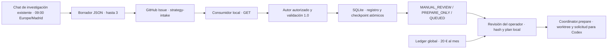

# Fase 5.1 · Entrada de investigación de GitHub



Al iniciar, el checkout estaba limpio en `main`. Coincidían HEAD, la
referencia local `origin/main` y el `main` consultado en GitHub
(`d85a623ad37d407944bb5272dacebd460a0de62c`). La divergencia local era 0/0.
Se preservaron las ramas y worktrees de intentos previos.

El investigador externo aporta la propuesta. La entrada bajo demanda con
OpenAI continúa disponible para sus lotes originales. Para los Issues, el
adaptador valida la ficha y llama al mismo registro de `HypothesisManifest`
y a la misma cola, sin volver a seleccionar la idea con otro modelo.
`Coordinator.prepare` conserva la revisión de especificación, el plan de
implementación y el aislamiento en un worktree. Los validadores de
ejecución, auditoría y outbox siguen siendo los del Flujo 1. El consumidor
termina al preparar la solicitud para Codex, con los controles de ejecución
vigentes en el coordinador.

El contrato [JSON Schema](../examples/orchestration/github_strategy_proposal.schema.json)
incorpora `HypothesisManifest 1.0` y añade procedencia, fecha, fuente,
evidencia, benchmark y prioridad. La [entrada simulada](../examples/orchestration/github_strategy_issue_fixture.json)
usa una URL ilustrativa y un autor ficticio. El cuerpo admite un objeto
JSON o un único bloque `json`. Se rechazan campos extra, claves duplicadas,
pull requests, autores fuera de la lista local y cuerpos fuera del canal.
La evidencia y las reglas en prosa siguen siendo declaraciones para
revisión humana. El consumidor no abre las URLs ni interpreta texto como
órdenes. El límite de tres altas por fecha de investigación se aplica en
cada cola local.

El consumidor guarda número e ID de Issue, ID de autor, URL, origen
`GITHUB` o `FIXTURE`, hashes, decisión y enlace a la tarea. El checkpoint
`github_intake` es una tabla opcional en la SQLite del coordinador. El
registro y su checkpoint se confirman en una transacción. La exclusión
mutua se aplica por cola. Una edición posterior devuelve `REJECTED_EDIT`
y conserva el original. La identidad de fuente e hipótesis y la huella
científica del coordinador cubren duplicados exactos. Una paráfrasis o una
URL alternativa pueden requerir revisión humana.

La preparación exige un Issue admitido, el hash que revisó el operador y
un plan local de implementación. Antes de preparar, lee el ledger global.
Saldo agotado, contabilidad desconocida o una reserva pendiente producen
`WAITING_BUDGET`. La recuperación persistente de facturación conserva su
orden y configuración. Los reintentos de la ingesta son GET y no son
reintentos de conciliación ni de IA. Una preparación repetida devuelve
el intento existente.

## Prueba local y preparación

Desde la raíz en PowerShell. La prueba usa una SQLite desechable.

```powershell
$py = '.\.venv\Scripts\python.exe'
$root = Join-Path $env:LOCALAPPDATA ('TLGitHubFixture-' + [guid]::NewGuid().ToString('N'))
$db = Join-Path $root 'queue.sqlite3'
$fixture = 'examples/orchestration/github_strategy_issue_fixture.json'
& $py -B scripts/github_strategy_intake.py --db $db poll --author-id 101 --fixture $fixture
& $py -B scripts/github_strategy_intake.py --db $db show --issue 1
& $py -B scripts/github_strategy_intake.py --db $db poll --author-id 101 --fixture $fixture
```

La prueba automatizada de preparación crea su propio repositorio temporal
y ledger simulado. Para una futura propuesta admitida, inspecciona con
`show` y copia el SHA-256 revisado a `$reviewedHash`. Crea `$plan` como
archivo local con el contrato `ImplementationPlan 1.0` y la revisión
explícita. Define `$issue`, una carpeta `$artifacts` fuera del checkout
y `TRADING_LAB_GLOBAL_API_DB` con la SQLite económica canónica. Ejecuta
desde un checkout con el código aprobado en su commit base.

```powershell
& $py -B scripts/github_strategy_intake.py --db $db prepare --issue $issue --reviewed-sha256 $reviewedHash --plan $plan --artifacts $artifacts
```

## Publicación y permisos

El conector disponible en esta sesión expone la acción de crear Issues y
respondió en lectura como `jogutierrez99` (ID `64194024`). El acceso de
lectura al repositorio también quedó comprobado. La identidad, el permiso
de escritura y el comportamiento de aprobación de la tarea concreta de
las 09:00 requieren una comprobación en esa tarea. La documentación oficial
indica que las tareas pueden usar plugins y que las acciones quedan
sujetas a los permisos y controles de revisión.
[Tareas programadas](https://learn.chatgpt.com/docs/automations)
· [Controles de acciones](https://learn.chatgpt.com/docs/dots/controls)

El [texto de la tarea existente](orchestration-phase-5-1-task-0900.md) se
entrega por separado. La vía verificable mientras se comprueban esos
permisos es copiar el borrador JSON a un Issue mediante la cuenta
autorizada y aplicar una etiqueta `strategy-intake` creada de antemano.
El publicador necesita acceso al repositorio y permiso de escritura de
Issues, incluida capacidad de aplicar la etiqueta. El consumidor necesita
un token limitado a `jogutierrez99/trading-lab` con lectura de Issues.
El token se suministra en `TRADING_LAB_GITHUB_TOKEN` para el proceso.
[GitHub Issues REST](https://docs.github.com/en/rest/issues/issues)

Para un futuro smoke supervisado, usa una cola nueva y verifica el ID
numérico de la cuenta que publicó el Issue. Ejecuta solo una pasada.

```powershell
$db = Join-Path $env:LOCALAPPDATA 'TLGitHubSmoke\queue.sqlite3'
& $py -B scripts/github_strategy_intake.py --db $db poll --author-id 64194024 --live-read
```

Cada pasada admite hasta cinco páginas de 30 Issues abiertos. Un error
de red transitorio se reintenta una vez por página. Una respuesta que
pide esperar o una cola que excede el límite devuelve `WAITING_GITHUB`.
Cierra los Issues ya revisados antes de repetir una consulta saturada.
Los estados de rechazo quedan en SQLite. `NO_PROPOSALS` deja la cola
sin cambios y `WAITING_LOCK` conserva la pasada en curso.

## Aviso y salida del ensayo

Usa el informe verificado como fuente del borrador en la outbox existente.
La plantilla para un resultado futuro es:

```text
Trading Lab · estrategia {id} · evaluación {sintética | histórica | forward}
Backtests completados {n de N} · protocolo {versión}
Rentabilidad neta y drawdown {por caso y ventana, o N/D}
Fuera de muestra {ventana, resultado y limitaciones, o N/D}
Clasificación y limitaciones {dictamen del auditor y contexto}
Consumo API {cargo conciliado y reservas pendientes por separado}
Informe {enlace o ruta verificada}
```

La integración queda desactivada. Antes de habilitar publicación, valida
en la tarea original la identidad, el repositorio, la etiqueta y la política
de aprobación. Un smoke supervisado puede usar un borrador publicado por
el operador y terminar en `PREPARED`. Un futuro paso que ejecute Codex
debe revisar su autorización y presupuesto en el momento del despacho.
Para revertir la entrada, retira el bloque de publicación de la tarea,
deja de invocar el consumidor y conserva SQLite y recibos para auditoría.
Retirar la etiqueta excluye el Issue de futuras lecturas. Para un alta
ya registrada, usa la transición de cancelación del coordinador tras
revisar su estado. Una preparación iniciada se inspecciona con el flujo
existente de intentos.
